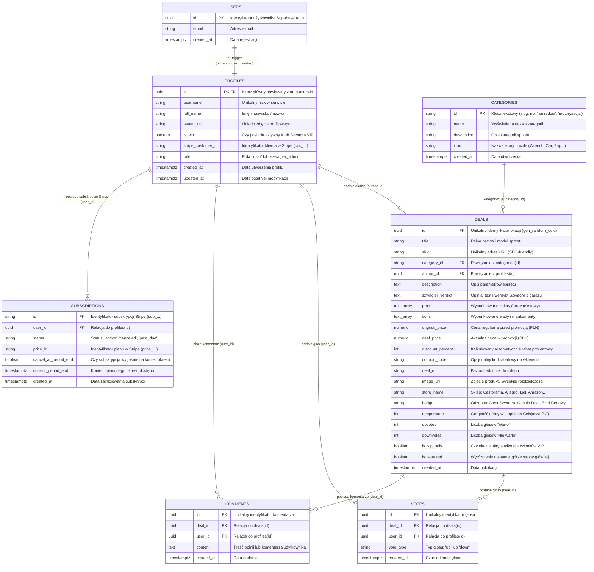

# 🗄️ Schemat i Architektura Bazy Danych: szwagierpoleca.pl

Wizualna mapa powiązań relacyjnych (PostgreSQL w chmurze Supabase) zintegrowana z autoryzacją użytkowników i subskrypcjami Stripe.

---

## 1. Diagram Relacji Bazy Danych (ERD)



---

## 2. Architektura Przepływu Danych (Supabase + Stripe)

```mermaid
flowchart TD
    subgraph Uzytkownik["👤 Użytkownik / Przeglądarka"]
        Browser[Klient Next.js 14]
    end

    subgraph SupabaseAuth["🔐 Supabase Auth"]
        AuthRegister[Rejestracja e-mail / Magic Link]
        TriggerUser[Trigger: on_auth_user_created]
    end

    subgraph BazaPostgres["🐘 Baza Supabase (PostgreSQL)"]
        TabProfiles[(profiles)]
        TabCategories[(categories)]
        TabDeals[(deals)]
        TabVotes[(votes)]
        TabComments[(comments)]
        TabSubscriptions[(subscriptions)]
    end

    subgraph BramkaStripe["💳 Stripe Payments API"]
        StripeCheckout[Stripe Checkout Session]
        StripeWebhook[/api/webhook]
        CustomerPortal[Stripe Customer Portal]
    end

    %% Rejestracja
    Browser -->|1. Rejestracja| AuthRegister
    AuthRegister -->|2. Wyzwolenie triggera| TriggerUser
    TriggerUser -->|3. Utworzenie rekordu| TabProfiles

    %% Przeglądanie i interakcje
    Browser -->|Odczyt publiczny RLS| TabDeals
    Browser -->|Odczyt| TabCategories
    Browser -->|Głosowanie| TabVotes
    Browser -->|Komentowanie| TabComments
    TabVotes -->|Aktualizacja temperatury| TabDeals

    %% Płatności VIP
    Browser -->|4. Kliknięcie 'Wybierz plan'| StripeCheckout
    StripeCheckout -->|5. Płatność udana| StripeWebhook
    StripeWebhook -->|6. Aktywacja is_vip = true| TabProfiles
    StripeWebhook -->|7. Zapis subskrypcji| TabSubscriptions
    Browser -->|8. Zarządzanie subskrypcją| CustomerPortal
```

---

## 3. Zestawienie Tabel i Reguł Bezpieczeństwa (RLS)

| Tabela | Klucz Główny (PK) | Klucze Obce (FK) | Reguła RLS (Row Level Security) |
| :--- | :--- | :--- | :--- |
| **`profiles`** | `id` (UUID) | `id -> auth.users(id)` | Publiczny odczyt; edycja tylko dla właściciela konta (`auth.uid() = id`). |
| **`categories`** | `id` (TEXT) | *brak* | Publiczny odczyt dla każdego odwiedzającego. |
| **`deals`** | `id` (UUID) | `category_id -> categories(id)`<br>`author_id -> profiles(id)` | Publiczny odczyt dla standardowych okazji; okazje VIP tylko dla użytkowników z `is_vip = true`. Dodawanie dla zalogowanych. |
| **`votes`** | `id` (UUID) | `deal_id -> deals(id)`<br>`user_id -> profiles(id)` | Odczyt publiczny; dodawanie i edycja dla zalogowanego użytkownika (`UNIQUE(deal_id, user_id)` zapobiega podwójnemu głosowaniu). |
| **`comments`** | `id` (UUID) | `deal_id -> deals(id)`<br>`user_id -> profiles(id)` | Odczyt publiczny; dodawanie dla zalogowanych użytkowników. |
| **`subscriptions`**| `id` (TEXT) | `user_id -> profiles(id)` | Dostęp administracyjny (Service Role) zsynchronizowany z webhookami Stripe. |
