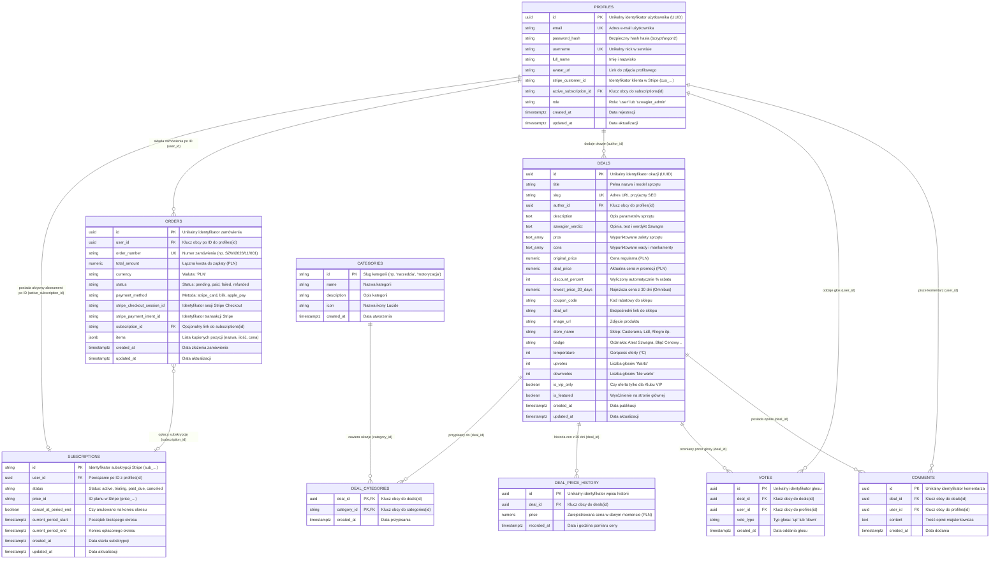

# 🗄️ Zaktualizowany Schemat i Architektura Bazy Danych: szwagierpoleca.pl

Wizualna mapa powiązań relacyjnych (PostgreSQL / Supabase) po wdrożeniu zmian architektonicznych:
1. **Relacja M:N (Wiele-do-Wielu)**: Jeden produkt może należeć do wielu kategorii jednocześnie (`deal_categories`).
2. **Sub-tabela historii cen z 30 dni**: Śledzenie historii cen i dyrektywa Omnibus (`deal_price_history`).
3. **Ujednolicona tabela użytkowników**: `profiles` jako jedyna tabela użytkowników z polami `email` i `password_hash`.
4. **Tabela zamówień**: Nowa tabela `orders` ewidencjonująca płatności i zamówienia.
5. **Precyzyjna relacja subskrypcji po ID**: `profiles.active_subscription_id` oraz `subscriptions.user_id` powiązane bezpośrednio po kluczach ID.

---

## 1. Zaktualizowany Diagram Relacji Bazy Danych (ERD)



---

## 2. Architektura Przepływu Danych i Integracji ze Stripe

```mermaid
flowchart TD
    subgraph Klient["👤 Interfejs Użytkownika (Next.js 14)"]
        UI_Home[Strona Główna / Okazje]
        UI_Deals[Karta Okazji + Wykres Cen 30 Dni]
        UI_Checkout[Zakup VIP / Płatność]
    end

    subgraph Backend["⚡ Backend Next.js API"]
        API_Checkout[/api/checkout]
        API_Webhook[/api/webhook]
        API_Vote[/api/deals/vote]
    end

    subgraph BazaPostgres["🐘 Baza Supabase (PostgreSQL)"]
        TabProfiles[(profiles)]
        TabSubscriptions[(subscriptions)]
        TabOrders[(orders)]
        TabDeals[(deals)]
        TabDealCategories[(deal_categories)]
        TabCategories[(categories)]
        TabPriceHistory[(deal_price_history)]
        TabVotes[(votes)]
        TabComments[(comments)]
    end

    subgraph StripeAPI["💳 Bramka Płatności Stripe"]
        StripeSession[Stripe Checkout Session]
        StripeEvent[Zdarzenie Webhook: checkout.session.completed]
    end

    %% Przepływ przeglądania okazji
    UI_Home -->|Filtrowanie wielokrotnych kategorii| TabDealCategories
    TabDealCategories --> TabCategories
    TabDealCategories --> TabDeals
    UI_Deals -->|Pobranie historii cen z 30 dni| TabPriceHistory
    TabPriceHistory -->|Trigger wyliczający najniższą cenę| TabDeals

    %% Przepływ zamówienia i subskrypcji
    UI_Checkout -->|1. Inicjalizacja zamówienia| API_Checkout
    API_Checkout -->|2. Utworzenie rekordu 'pending'| TabOrders
    API_Checkout -->|3. Wygenerowanie sesji| StripeSession
    StripeSession -->|4. Klient płaci (Karta / BLIK)| StripeEvent
    StripeEvent -->|5. Potwierdzenie webhookiem| API_Webhook
    API_Webhook -->|6. Aktualizacja zamówienia na 'paid'| TabOrders
    API_Webhook -->|7. Zapis subskrypcji z ID| TabSubscriptions
    API_Webhook -->|8. Powiązanie po ID: active_subscription_id| TabProfiles
```

---

## 3. Podsumowanie Wprowadzonych Usprawnień

| Element | Wcześniej | Teraz (Po Zmianach) | Dlaczego tak jest lepiej? |
| :--- | :--- | :--- | :--- |
| **Relacja Okazja ➔ Kategoria** | 1:N (jedno pole `category_id` w `deals`) | **M:N (Tabela łącząca `deal_categories`)** | Sprzęt może należeć do kilku kategorii (np. klucz pneumatyczny jest jednocześnie w *Narzędziach* i *Motoryzacji*). |
| **Historia cen** | Brak sub-tabeli | **Sub-tabela `deal_price_history` z indeksem 30 dni** | Pozwala rysować wykres zmian cen, wykrywać sztuczne promocje i realizować wymogi unijnej dyrektywy Omnibus. |
| **Tabela użytkowników** | Dwie tabele (`users` + `profiles` bez hasła) | **Jedna tabela `profiles` z polami `email` i `password_hash`** | Czysta, przejrzysta architektura bez niepotrzebnych powtórzeń, pełna kontrola nad danymi konta. |
| **Tabela zamówień** | Brak | **Tabela `orders` z numerem zamówienia, kwotą i statusem** | Pełna ewidencja zakupów (Klub VIP, produkty, gadżety), historia transakcji i integracja ze Stripe. |
| **Połączenie użytkownika z subem** | Luźna flaga logiczna `is_vip: boolean` | **Ścisła relacja po ID (`active_subscription_id` ➔ `subscriptions.id`)** | Eliminacja błędów niespójności. Status VIP wynika bezpośrednio z konkretnego rekordu i ID aktywnej subskrypcji w Stripe. |
